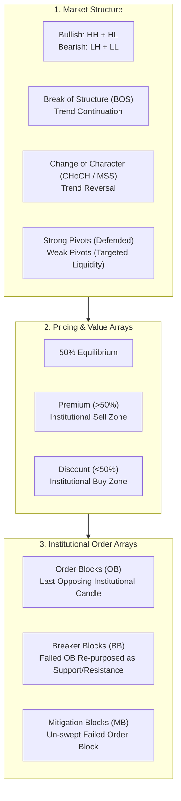
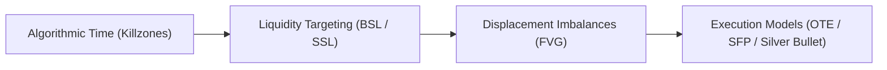
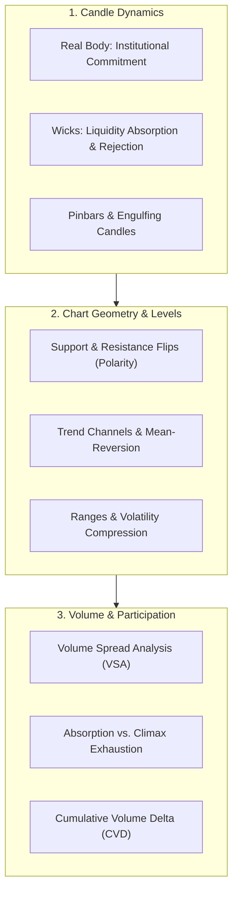

# The Institutional Trading Encyclopedia: SMC, ICT & Price Action

An exhaustive reference manual covering the theoretical foundations, structural mechanics, timing algorithms, and execution setups across **Smart Money Concepts (SMC)**, **Inner Circle Trader (ICT)**, and **Classical Price Action**.

---

## 1. Smart Money Concepts (SMC)

Smart Money Concepts analyze the footprint of institutional market participants (banks, hedge funds, liquidity providers) by tracking how capital is accumulated, defended, and distributed.

### 1.1 Market Structure
* **Break of Structure (BOS):** A candle-body close beyond a previous swing high in an uptrend (or swing low in a downtrend), signaling continuation of the prevailing institutional order flow.
* **Change of Character (CHoCH / MSS):** The first structural break of the opposing swing low/high, indicating an initial shift in market control from buyers to sellers (or vice versa).
* **Internal vs. External Structure:**
  * *External Structure:* Major swing highs and swing lows on higher timeframes (Daily, 4H, 1H) that define the macro dealing range.
  * *Internal Structure:* Sub-structure waves (15m, 5m) within the macro leg used for tactical entry timing.
* **Strong vs. Weak Highs/Lows:**
  * *Strong High/Low:* A pivot that successfully created a new BOS; institutional capital defended it, making it difficult to breach.
  * *Weak High/Low:* A pivot that failed to make a new high/low; treated as targeted liquidity waiting to be swept.
* **Inducement (IDM):** A minor, deceptive pullback designed to entice retail breakout traders into entering early, creating fresh liquidity right before the institutional order block is tapped.

### 1.2 Premium & Discount Pricing (PD Arrays)
* **50% Equilibrium:** The exact midpoint of the active dealing range.
* **Discount Zone (< 50%):** The lower half of the range where asset valuation is cheap; institutional smart money exclusively accumulates longs here.
* **Premium Zone (> 50%):** The upper half of the range where valuation is expensive; smart money distributes long inventory and initiates short hedges here.

### 1.3 Institutional Order Arrays
* **Order Block (OB):** The final down-close candle prior to an aggressive upward displacement impulse (Bullish OB), or the final up-close candle prior to an aggressive downward collapse (Bearish OB).
* **Breaker Block (BB):** An order block that failed to hold and was forcefully breached by a liquidity sweep. Once broken, its polarity flips (a failed bullish OB becomes strong bearish resistance).
* **Mitigation Block (MB):** Similar to a breaker block, but formed when price fails to sweep the previous extreme high/low before breaking structure.
* **Rejection Block:** The long wicks at key swing extremes where institutions absorbed liquidity without closing candle bodies.

---

## 2. Inner Circle Trader (ICT)

The ICT framework, pioneered by Michael J. Huddleston, is built around algorithmic time, liquidity delivery (IPDA), and session timing.

### 2.1 Time & Algorithmic Timing
* **Interbank Price Delivery Algorithm (IPDA):** The theoretical algorithmic engine that delivers price to resting liquidity pools or rebalances fair value imbalances.
* **True Day Open / Midnight Open:** 00:00 New York Time (EST). Setting the daily opening price; moves below midnight open are evaluated as discount manipulation for longs.
* **8:30 AM New York Open:** The release time for major U.S. macroeconomic data (CPI, NFP, GDP), triggering institutional volatility injections.
* **Killzones (Execution Windows):**
  * **Asian Killzone:** 20:00 – 00:00 NY Time (05:30 – 09:30 IST). Accumulates initial range boundaries.
  * **London Open Killzone:** 02:00 – 05:00 NY Time (12:30 – 15:30 IST). Frequently engineers the daily low or high via the Judas Swing.
  * **New York Open Killzone:** 07:00 – 10:00 NY Time (18:30 – 21:30 IST). High-momentum session delivering continuation or macro daily reversals.
  * **London Close Killzone:** 10:00 – 12:00 NY Time (20:30 – 22:30 IST). Profit taking, counter-trend retracements, and daily range consolidation.

### 2.2 Liquidity Framework
* **Buy-Side Liquidity (BSL):** A cluster of resting buy-stop orders placed by short sellers (protective stops) and breakout buyers above key swing highs, session highs, or equal highs.
* **Sell-Side Liquidity (SSL):** A cluster of resting sell-stop orders placed below swing lows, session lows, or equal lows.
* **Equal Highs (EQH) / Equal Lows (EQL):** Double or triple tops/bottoms. Algorithmic price magnets that retail traders misinterpret as "strong resistance/support", which institutions sweep cleanly.
* **Internal Range Liquidity (IRL) vs. External Range Liquidity (ERL):** The cyclical algorithm delivery path: price sweeps external liquidity (highs/lows), then retraces to balance internal liquidity (FVGs), then expands to the next external pool.

### 2.3 Imbalance Taxonomy
* **Fair Value Gap (FVG):** A 3-candle price run where Candle 1 and Candle 3 wicks do not overlap, leaving an inefficiency:
  * *BISI (Buyside Imbalance Sellside Inefficiency):* Bullish gap where buyers displaced price so fast that sellers were excluded.
  * *SIBI (Sellside Imbalance Buyside Inefficiency):* Bearish gap where aggressive selling left an unmitigated pocket.
* **Inversion FVG (iFVG):** When an active FVG fails to support price and is closed through with body displacement, it flips into an opposing support/resistance barrier.
* **Balanced Price Range (BPR):** A region where a bullish FVG and a bearish FVG overlap, representing thoroughly balanced two-way trade.
* **Volume Imbalance (VI):** An opening gap between the real bodies of consecutive candles where wicks overlap but bodies do not.

### 2.4 ICT Core Execution Models
* **Power of 3 (AMD):**
  1. *Accumulation:* Smart money builds base positions in a tight range (often Asian session).
  2. *Manipulation (Judas Swing):* A false breakout in the wrong direction to sweep liquidity and trap retail participants.
  3. *Distribution:* The genuine, high-volume expansion toward the true target of the day.
* **Optimal Trade Entry (OTE):** Measuring a displacement impulse with the Fibonacci retracement tool:
  * 61.8% Retracement (Equilibrium anchor)
  * **70.5% Retracement (The Sweet Spot)**
  * 79.0% Retracement (Deep institutional discount boundary)
* **Swing Failure Pattern (SFP / Turtle Soup):** Price breaks beyond a 20-period, session, or daily high/low to trigger stops, but fails to close beyond it on the candle body, immediately snapping back inside the range.
* **SMT Divergence (Smart Money Tool):** Correlated asset divergence (e.g. Bitcoin prints a lower low while Ethereum prints a higher low at the same timestamp), revealing underlying institutional absorption.
* **Silver Bullet:** A systematic 60-minute window (10:00–11:00 AM NY / 03:00–04:00 AM NY) where price delivers a minimum 15m/5m FVG retest targeting unmitigated session liquidity.

---

## 3. Classical Price Action

Classical Price Action studies pure chart geometry, candle dynamics, and supply-demand interactions without relying on lagging indicators.

### 3.1 Candlestick Dynamics & Behavioral Psychology
* **Real Body vs. Wick Ratio:**
  * *Long Candle Body:* Strong institutional participation, displacement, and one-sided aggression.
  * *Long Wick with Tiny Body (Pinbar):* Aggressive passive limit absorption; the side that pushed price was completely rejected before the close.
* **Engulfing Patterns:** A candle whose real body completely engulfs the prior candle's body, signaling an immediate regime shift.
* **Inside Bar / Compression:** A candle contained entirely within the high-to-low range of the previous candle, signaling energy coil before expansion.

### 3.2 Key Horizontal Levels & Polarity Principle
* **Support / Resistance Flip:** The structural rule that once a validated support level is broken, it becomes future resistance (and vice versa) due to trapped traders looking to exit at breakeven.
* **Swing Pivots:** Fractal 3-bar and 5-bar swing highs/lows that anchor chart geometry.
* **Round Number Psychology:** Significant psychological milestones (e.g. `$80,000`, `$85,000`, `$100,000`) where retail stop orders and options open interest naturally cluster.

### 3.3 Volume & Order Flow Dynamics
* **Volume Spread Analysis (VSA):**
  * *High Volume with Small Spread (Absorption):* Institutional limit orders absorbing massive market orders without letting price move further.
  * *Ultra-High Volume with Long Wick (Stopping Volume / Climax):* Capitulation event marking the end of a trend.
  * *Low Volume Push into Support/Resistance (Exhaustion):* Lack of market participation; easily rejected.
* **Cumulative Volume Delta (CVD):** The cumulative net difference between aggressive market buys and aggressive market sells at the bid/ask.

---

## 4. Master Comparative Taxonomy

| Topic Dimension | Smart Money Concepts (SMC) | Inner Circle Trader (ICT) | Classical Price Action |
| :--- | :--- | :--- | :--- |
| **Trend Reversal** | Change of Character (CHoCH) | Market Structure Shift (MSS) | Trendline Break / Lower High |
| **Trend Continuation** | Break of Structure (BOS) | Expansion / Displacement | Higher High / Resistance Break |
| **Support / Supply** | Bullish Order Block (OB) | Mitigation Block / Bullish FVG | Demand Zone / Horizontal Support |
| **Failed Support** | Bearish Breaker Block (BB) | Inversion FVG (iFVG) | Support-turned-Resistance (S/R Flip) |
| **False Breakout** | Liquidity Sweep / Fakeout | Judas Swing / Turtle Soup (SFP) | Bull / Bear Trap |
| **Value Zone** | 50% Equilibrium Discount | Optimal Trade Entry (OTE 70.5%) | Fibonacci 61.8% Retracement |
| **Timing Element** | Session Overlap | Algorithmic Killzones (NY Time) | Market Open / Bell Volume |
| **Target Mechanism** | External Range Highs/Lows | Buy-Side / Sell-Side Liquidity | Prior Pivot Resistance / Measure Moves |

---

## 5. Execution Integration: The Confluence Checklist

To formulate an institutional-grade trading setup, professional desks require alignment across all three disciplines:

1. **Macro Timing (ICT):** Must trade inside the **London (12:30–15:30 IST)** or **New York (18:30–21:30 IST)** Killzone.
2. **Context & Liquidity (SMC + ICT):** Price must first sweep a major liquidity pool (**BSL/SSL**) to clear stops.
3. **Confirmation (Price Action + SMC):** Must wait for a full **15-minute candle close** confirming a **Market Structure Shift (MSS)** with an absorption wick.
4. **Valuation (SMC + ICT):** Enter exclusively inside a **Discount FVG (<50% Equilibrium)** at the **OTE (62%–79%)** zone.
5. **Defense & Target:** Hard Stop Loss placed beyond the sweep wick; Take Profit laddered to the opposing untouched **Equal Highs / BSL pool** for $\ge 1:2.5$ R:R.
