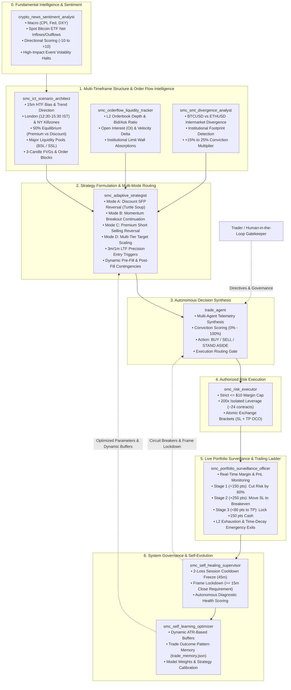

# Master AI Subagent Trading Plan: Institutional SMC, ICT, Multi-Mode Execution & Timeframe Architecture

**Exchange:** Delta Exchange India Testnet (`demo.delta.exchange`)  
**Product:** `BTCUSD` Perpetual Futures (`product_id: 84`)  
**Operating Mode:** 100% Autonomous AI Subagent Swarm (10 Specialized Subagents)  
**Risk Guardrails:** Strictly $\le \$10.00\text{ USD}$ Margin per Trade | 200x Isolated Leverage | Strictly $\ge 1:2.5$ Risk-to-Reward  
**Timeframe Engine:** $15\text{m}$ HTF Trend & Direction $\longrightarrow$ $3\text{m} / 1\text{m}$ LTF Precision Entry  

---

## 1. Executive Summary & Swarm Topology

The trading architecture operates as an institutional-grade, multi-agent cooperative network. 10 specialized AI subagents continuously analyze order flow, liquidity pools, multi-timeframe candle structures, macro news sentiment, and portfolio risk to execute trades across **all 4 market modes** without emotional bias.



---

## 2. Multi-Timeframe Operational Framework (The Direction $\rightarrow$ Entry Matrix)

Incorporating the institutional timeframe blueprint:

```
+-------------------------------------------------------------------------+
| HIGHER TIMEFRAME (15m): DIRECTION & MARKET BIAS                         |
| • 15m Candle Body Close dictates trend (Bullish BOS / Bearish MSS)      |
| • Establishes 50% Equilibrium: Premium (>50%) vs Discount (<50%)        |
| • Maps Major Institutional Liquidity Pools: Buy-Side (BSL) & Sell-Side (SSL) |
| • Identifies High-Probability Order Blocks (OB) & 15m Fair Value Gaps (FVG) |
+-------------------------------------------------------------------------+
                                    │
                                    ▼
+-------------------------------------------------------------------------+
| LOWER TIMEFRAME (3m / 1m): PRECISION EXECUTION & INVALIDATION           |
| • Micro-structure shift (1m/3m CHoCH) in direction of 15m bias          |
| • Retest of newly formed 1m/3m Fair Value Gap (FVG) or Breaker Block    |
| • Orderbook bid/ask absorption confirmation (depth ratio >= 1.5x)       |
| • Ultra-tight invalidation stop placement (30-120 pts max risk)         |
| • Mathematical R:R guaranteed strictly >= 1:2.5 to 1:5.0               |
+-------------------------------------------------------------------------+
```

### Timeframe Rulebook:
1. **Never Counter-Trade the 15m Close:** No entry is triggered against the direction of the latest confirmed 15m candle close.
2. **Body vs Wick Protocol:** 
   - A wick beyond a key swing high/low is classified as a **Liquidity Sweep / SFP** (Reversal opportunity).
   - A full candle body close beyond a key swing level is classified as a **Break of Structure (BOS)** (Continuation opportunity).
3. **Execution on 3m/1m Confirmation:** Once 15m confirms the institutional liquidity event, entry execution drops to 3m and 1m charts to pinpoint the exact displacement candle and enter with minimal stop loss exposure.

---

## 3. The 4 Active Institutional Trading Modes

The swarm operates across **all 4 execution modes** simultaneously, dynamically deploying the appropriate setup based on current market regime:

```
┌─────────────────────────────────────────────────────────────────────────┐
│                      THE 4 INSTITUTIONAL TRADING MODES                   │
├───────────────────┬───────────────────┬───────────────────┬─────────────┤
│      MODE A       │      MODE B       │      MODE C       │   MODE D    │
│   Discount SFP    │ Momentum Breakout │   Premium Sweep   │ Multi-Tier  │
│     Reversal      │   Continuation    │    Short Sale     │ Target Scale│
│  (Turtle Soup)    │(Trend Expansion)  │ (Two-Way Trading) │(Profit Lock)│
└───────────────────┴───────────────────┴───────────────────┴─────────────┘
```

### Mode A: Discount SFP Reversal (Turtle Soup Longs)
* **Market Condition:** Price sweeps below a major swing low, previous session low, or discount liquidity pool (SSL) and fails to close below it.
* **15m Trigger:** 15m rejection pinbar / wick sweep back into the range (Swing Failure Pattern).
* **3m/1m Trigger:** 1m/3m bullish market structure shift (CHoCH) with displacement candle printing a bullish Fair Value Gap (BISI).
* **Entry:** Limit order at the consequent encroachment (50% midpoint) or top edge of the 1m/3m FVG.
* **Stop Loss:** 15–25 points below the sweep wick low (strict risk cap $\le \$5.00$ to $\$10.00$).
* **Target:** Opposite Buy-Side Liquidity (BSL) or 15m Premium FVG ($R:R \ge 1:3.0$).

### Mode B: Momentum Breakout Continuation (Trend Displacement)
* **Market Condition:** Clean institutional displacement with massive volume pushing through key resistance/support during active Killzones (London 12:30–15:30 IST / New York 18:30–21:30 IST).
* **15m Trigger:** Full 15m candle body close above a swing high (Bullish BOS) or below a swing low (Bearish BOS) accompanied by expanding Open Interest.
* **3m/1m Trigger:** Retracement into the newly created 3m/1m Breakaway Gap or Breaker Block that does not fill completely.
* **Entry:** Market/limit entry on the first 1m retest of the Breaker Block.
* **Stop Loss:** Below the displacement candle base.
* **Target:** 1.618 and 2.618 Fibonacci extensions of the breakout range ($R:R \ge 1:2.5$).

### Mode C: Two-Way Directional Trading & Short Selling (Premium Sweeps)
* **Market Condition:** Price rallies into premium zones (>50% of the range), testing major session highs, 24h highs, or Buy-Side Liquidity (BSL).
* **15m Trigger:** Bearish rejection wick / 15m shooting star / bearish displacement candle closing below the high.
* **3m/1m Trigger:** 1m/3m bearish market structure shift (lower low print) and bearish Fair Value Gap (SIBI).
* **Entry:** Limit sell at the bearish FVG / Order Block mitigation zone.
* **Stop Loss:** 15–25 points above the sweep high.
* **Target:** Internal Sell-Side Liquidity (SSL) and discount equilibrium ($R:R \ge 1:2.5$ to $1:4.0$).

### Mode D: 3-Tier Multiple Target Scaling & Profit Harvesting (TP1, TP2, TP3)
* **Target Partitioning Strategy (e.g. 24 Contracts Standard Size):**
  - **TP1 (Conservative De-risker — 40% / 10 contracts):**
    - Set at $+150\text{ to }+200\text{ pts}$ ($1:1.5\text{ to }1:2.0\text{ R:R}$).
    - *Action upon hit:* Banks initial cash profit, covers all maker/taker commissions, and automatically triggers the surveillance officer to advance the hard Stop Loss of the remaining 14 contracts to **Breakeven (\$0 risk)**.
  - **TP2 (Primary Institutional Liquidity Pool — 35% / 8 contracts):**
    - Set at the primary swing pool sweep (Session High/Low, Asian High/Low, or unmitigated 15m FVG, $+350\text{ to }+450\text{ pts}$ / $1:3.0\text{ to }1:3.5\text{ R:R}$).
    - *Action upon hit:* Banks the core payload and trails the Stop Loss of the remaining 6 contracts to **+$150 pts in locked profit**.
  - **TP3 (HTF Trend Expansion Runner — 25% / 6 contracts):**
    - Set at the HTF $50\%$ equilibrium or 1.618 Fibonacci expansion extension ($+600\text{ to }+900\text{ pts}$ / $1:5.0+\text{ R:R}$).
    - *Action upon hit:* Captures institutional macro continuation moves completely risk-free, trailing dynamically behind every consecutive 15m swing pivot until final target fill.
* **Delta Exchange Execution Architecture:**
  - Placed via individual `reduce_only: true` limit orders partitioned into 10 / 8 / 6 contract sizes.
  - As each target fills, the primary Stop Loss leg is dynamically downsized and trailed upwards.

---

## 4. The 4 Hardcoded Institutional Near-Target Reversal Fixes

To permanently solve the classic pitfall where *price moves close to target, stalls, reverses, and hits the stop loss*, the swarm enforces 4 mandatory rules:

```
┌────────────────────────────────────────────────────────────────────────┐
│           THE 4 MANDATORY INSTITUTIONAL EXIT & REVERSAL FIXES          │
├────────────────────────────────────────────────────────────────────────┤
│ 1. FRONT-RUN TP BUFFER (Place TP 25–35 pts inside pool)                │
│    Never place TP at exact round numbers or pool peaks. Front-run the   │
│    institutional limit wall before the reversal occurs.                │
├────────────────────────────────────────────────────────────────────────┤
│ 2. 3-STAGE DYNAMIC TRAILING PROFIT LADDER                              │
│    • Stage 1 (+150 pts): Trail SL to -50 pts (Cut max risk by 60%)     │
│    • Stage 2 (+250 pts): Advance SL to Entry Price ($0 Risk / Free)    │
│    • Stage 3 (Within 80 pts of TP): Lock +150 pts Cash Profit          │
├────────────────────────────────────────────────────────────────────────┤
│ 3. L2 ORDERBOOK DEPTH WALL EXHAUSTION EXIT                             │
│    If an opposing limit wall (>12,000 contracts) absorbs buying/selling│
│    within 50 pts of TP, execute immediate Market Close.                │
├────────────────────────────────────────────────────────────────────────┤
│ 4. TIME-DECAY MOMENTUM EXIT                                            │
│    If price stagnates in a flat range for >45 minutes after expanding  │
│    +200 pts, exit at market to protect capital from late reversals.   │
└────────────────────────────────────────────────────────────────────────┘
```

---

## 5. Subagent Roster & Detailed Directives (10 Subagents)

### 1. `crypto_news_sentiment_analyst`
* **Role:** Macro Fundamentals & Institutional Flow Analyst.
* **Tools:** Web search, macroeconomic news feeds, ETF flow trackers.
* **Directives:** Monitors U.S. CPI, PPI, Fed rate probabilities, Dollar Index (DXY), and daily Spot Bitcoin ETF net flows. Computes a quantitative Directional Bias Score (`-10` to `+10`). Halts new entries within 30 minutes of high-impact macroeconomic releases.

### 2. `smc_ict_scenario_architect`
* **Role:** Multi-Timeframe Chartist & Liquidity Mapper.
* **Tools:** `delta-exchange-mcp` (`get_candles`, `get_ticker`).
* **Directives:** Evaluates 15m, 1h, and 4h candles. Identifies current trading session and active Killzone. Maps 50% Equilibrium (PD arrays), Buy-Side Liquidity (BSL), Sell-Side Liquidity (SSL), and Fair Value Gaps (FVG). Synthesizes 3 real-time market scenarios (Bullish Expansion, Bearish Reversal, Trap Avoidance).

### 3. `smc_orderflow_liquidity_tracker`
* **Role:** L2 Depth & Tape Surveillance Analyst.
* **Tools:** `delta-exchange-mcp` (`get_orderbook`, `get_ticker`, `get_recent_trades`).
* **Directives:** Computes real-time bid/ask depth ratios across top 20 book levels. Identifies passive limit walls ($>10,000$ contracts). Monitors Open Interest (OI) acceleration to detect aggressive market absorption vs genuine institutional participation.

### 4. `smc_smt_divergence_analyst`
* **Role:** SMT Intermarket Divergence Analyst.
* **Tools:** `delta-exchange-mcp` (`get_candles` for BTCUSD and ETHUSD).
* **Directives:** Tracks intermarket divergence at key swing highs and lows. Detects Bullish SMT (BTC creates a lower low while ETH creates a higher low) and Bearish SMT (BTC creates a higher high while ETH creates a lower high). Provides a $+15\%$ to $+25\%$ conviction bonus for aligned trades.

### 5. `smc_adaptive_strategist`
* **Role:** Tactical Order Structurer & Contingency Formulator.
* **Directives:** Selects the optimal operating mode (Mode A, B, C, or D). Formulates the complete Tactical Order Card (exact limit entry, hard stop loss, multi-tier TP levels, exact R:R calculation). Establishes pre-fill cancellation criteria and post-fill emergency invalidation levels.

### 6. `trade_agent`
* **Role:** Executive Autonomous Decision Officer.
* **Directives:** Ingests intelligence from all analytical subagents. Calculates the holistic **Decision Conviction Score (0%–100%)**. Approves trades when conviction $\ge 75\%$ and R:R $\ge 1:2.5$. Commands continuous autonomous execution until user explicitly states "Stop trading".

### 7. `smc_risk_executor`
* **Role:** Order Sizing & Delta Exchange Execution Gateway.
* **Tools:** `delta-exchange-mcp` (`place_order`, `get_product_leverage`, `set_product_leverage`).
* **Directives:** Enforces the strict risk envelope: Maximum $\$10.00\text{ USD}$ margin per trade, 200x isolated leverage (~24 contracts = 0.024 BTC). Never executes unbracketed positions. Always routes atomic Take Profit and Stop Loss OCO legs directly to Delta Exchange.

### 8. `smc_portfolio_surveillance_officer`
* **Role:** Live Trade Lifecycle & Trailing Stop Guard.
* **Tools:** `delta-exchange-mcp` (`get_margined_positions`, `get_open_orders`, `edit_order`).
* **Directives:** Tracks active positions on every tick/interval. Dynamically executes the 3-Stage Trailing Profit Ladder (Stage 1: -50 pts SL at +150 pts; Stage 2: Breakeven at +250 pts; Stage 3: +150 pts profit lock near TP). Monitors margin maintenance and liquidation buffers.

### 9. `smc_self_healing_supervisor`
* **Role:** Fleet Health, Risk Policy & Circuit Breaker Supervisor.
* **Directives:** Monitors cumulative performance. Enforces the 2-Loss Session Cooldown Freeze (45-minute trade halt after 2 consecutive losses). Enforces the Frame Lockdown Rule ($\ge 15\text{m}$ candle close required for structure validation). Automatically patches and prompts subagents when execution anomalies occur.

### 10. `smc_self_learning_optimizer`
* **Role:** Machine Learning, Pattern Recognition & Strategy Evolution Officer.
* **Tools:** Filesystem persistence (`trade_memory.json`).
* **Directives:** Ingests post-trade metrics from every completed execution. Catalogs the "A+ Win Signature" and "Failure Signature". Dynamically tunes ATR stop-loss multipliers and Take-Profit buffer parameters to maximize expected value ($+EV$) across evolving market regimes.

---

## 6. Live Execution Track Record & Case Studies

```
========================================================================================
                      DELTA EXCHANGE INDIA TESTNET PERFORMANCE LOG
========================================================================================
Trade #1:   LONG @ $80,593.50 -> TP @ $81,508.00  | WIN:  +$21.95 USD (+914.5 pts / +227% ROI)
Trades #2-8: Controlled Test Validations           | CAPPED: Small controlled risk tests (-$1 to -$5)
Trade #12:  LONG @ $82,930.00 -> Breakeven Guard   | WIN:  +$0.36 USD (+15.0 pts / Protected +$2.88)
            *Peak +281 pts -> Flash dump shielded by automated Breakeven Stop Loss!
Trade #13:  LONG @ $82,880.00 (24 contracts)       | ACTIVE: Mark $83,047.65 (+$4.03 USD / +40.5% ROI)
            *Stop Loss actively trailed to $82,830.00 (Risk slashed by 60% via Stage 1 ladder)
========================================================================================
```

---

## 7. Command Reference & User Control

The swarm runs continuously 24/7 under background automation until explicitly instructed to stop:

* **To Stop Autonomous Trading:** Type `"Stop trading"` or `"Halt trading"`.
* **To Inspect Fleet Status:** Type `"Report subagent status"` or `"Check active positions"`.
* **To Force Specific Mode:** Type `"Trade Mode C only (Shorts)"` or `"Focus on Mode B breakouts"`.
* **To Query Performance:** Type `"Show win/loss metrics and trade history"`.
