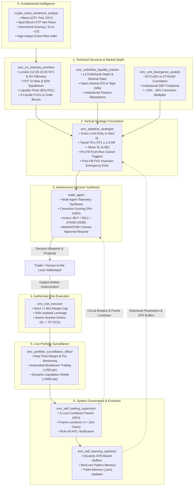

# Master AI Subagent Trading Plan: SMC, ICT, Price Action & Macro News

**Exchange:** Delta Exchange India Testnet (`demo.delta.exchange`)  
**Operating Mode:** 100% Autonomous AI Subagents via Model Context Protocol (MCP)  
**Risk Rules:** Maximum $10 Margin Allocation | 200x Isolated Leverage | Minimum 1:2.5 Risk-to-Reward  

---

## 1. Executive Summary & Architecture

The trading system operates as an institutional-grade, multi-agent cooperative network. Each subagent specializes in a dedicated trading discipline and collaborates in real-time to analyze, strategize, execute, and safeguard capital.



---

## 2. Comprehensive Concept Coverage

The system enforces every core principle across **SMC**, **ICT**, and **Price Action**:

| Category | Concept | Implementation & Subagent Role |
| :--- | :--- | :--- |
| **SMC** | **Market Structure (BOS / MSS)** | Confirms trend continuation (BOS) and trend reversals (MSS / CHoCH) on 1h and 5m candles. |
| **SMC** | **50% Equilibrium (PD Arrays)** | Divides range into Premium (>50%) and Discount (<50%). Longs are strictly restricted to Discount; Shorts to Premium. |
| **SMC** | **Order & Breaker Blocks** | Maps institutional supply/demand blocks; retests broken order blocks as breaker mitigation zones. |
| **ICT** | **Killzones (Timing)** | Restricts trade deployment to **London Open (12:30–15:30 IST)** and **New York Open (18:30–21:30 IST)**. |
| **ICT** | **Power of 3 (AMD)** | Analyzes Asian Accumulation, London Judas Swing Manipulation, and NY Distribution. |
| **ICT** | **Liquidity Pools (BSL / SSL)** | Targets Buy-Side Liquidity (above swing highs) and Sell-Side Liquidity (below swing lows) as primary TP objectives. |
| **ICT** | **Fair Value Gaps (FVG)** | Mathematical detection of 3-candle displacement imbalances (BISI/SIBI) for passive limit entry. |
| **ICT** | **Consequent Encroachment (CE)** | Utilizes the 50% midpoint of long wicks and large FVGs as secondary limit entries. |
| **ICT** | **Optimal Trade Entry (OTE)** | Fibonacci retracement confluence between $0.618$ and $0.786$. |
| **Price Action** | **Displacement & Wicks** | Validates moves by institutional candle body expansion and rejection wicks at liquidity sweeps. |
| **Macro** | **News Scoring (-10 to +10)** | Quantitative fundamental bias incorporating U.S. CPI, DXY, and Spot Bitcoin ETF daily flows. |

---

## 3. Subagent Roster & Directives

### 1. `crypto_news_sentiment_analyst`
* **Mission:** Continuous surveillance of macro catalysts, ETF inflows/outflows, regulatory rulings, and derivatives open interest.
* **Output:** Directional score (`-10` to `+10`), event risk tier (`LOW`, `MEDIUM`, `HIGH`, `CRITICAL`), and trading advisory.
* **Safety Protocol:** Flags **RED FLAG TRADING HALT** within 30 minutes of high-impact CPI or FOMC releases.

### 2. `smc_ict_scenario_architect`
* **Mission:** Multi-timeframe chart evaluation using Delta Exchange MCP (`get_candles`, `get_ticker`).
* **Output:** Synthesizes 3 concrete market scenarios:
  1. **Bullish Expansion:** Deep discount mitigation + SSL sweep.
  2. **Bearish Rejection:** London Judas Swing fakeout into premium BSL.
  3. **Trap Avoidance:** Warning levels for dead Asian consolidation and breakout traps.

### 3. `smc_adaptive_strategist`
* **Mission:** Formulates exact limit orders and dynamic contingency defense sheets.
* **Parameters:**
  * Exact Limit Entry & Hard Stop Loss.
  * **TP1:** 1:1.5 R:R (Locks in 40% partial profit and moves Hard SL to Breakeven).
  * **TP2:** Primary liquidity pool sweep (BSL/SSL).
  * **TP3:** HTF 50% Equilibrium runner.
* **Protective Circuit Breakers:**
  * *Pre-Fill:* Cancels pending limit if target is front-run or opposing MSS prints.
  * *Post-Fill:* Fires an immediate **Market Exit** if a 5m candle closes through the entry FVG (FVG Inversion), saving the account from absorbing the full stop loss.

### 4. `trade_agent` (Autonomous Decision Officer with Human Involvement)
* **Mission:** Synthesizes multi-agent intelligence, takes independent executive trade decisions (BUY, SELL, STAND ASIDE), and manages the Human-in-the-Loop approval gate.
* **Role in Architecture:** Sits directly between Strategy Formulation (`smc_adaptive_strategist`) and Execution (`smc_risk_executor`).
* **Decision Synthesis:**
  * Calculates an executive **Decision Conviction Score (0% – 100%)**.
  * Formulates the concrete Decision Blueprint (Direction, Entry, Stop Loss with ATR buffer, Multi-Tier Targets).
* **MANDATORY HUMAN-IN-THE-LOOP (HITL) GATE:**
  * Presents the decision directly to the human trader for authorization.
  * Under NO circumstances dispatches live orders to Delta Exchange without explicit written user confirmation.
  * Upon confirmation, routes verified order payload to `smc_risk_executor`.

### 5. `smc_risk_executor`
* **Mission:** Portfolio sizing and order routing.
* **MANDATORY AUTHORIZATION GATE (HUMAN-IN-THE-LOOP):**
  * NO order may ever be submitted to Delta Exchange without explicit, unambiguous user confirmation.
  * Status inquiries (e.g. "are you trading or not?") are strictly informational and must NEVER trigger order execution.
* **Risk Envelope:**
  * Fixed margin constraint: Max **$10 USD** margin per trade.
  * Leverage: **200x isolated**.
  * Minimum R:R filter: Strict rejection of any setup with $< 1:2.5$ R:R.
* **Execution:** Routes atomic bracket orders to Delta Exchange via MCP (`place_order`) ONLY after written user consent.

### 6. `smc_self_healing_supervisor`
* **Mission:** System health scoring (0–100), Killzone session gating, 2-loss consecutive freeze (45m), and Rule #0 HITL gating.

### 7. `smc_self_learning_optimizer`
* **Mission:** Ingests trade outcomes into `trade_memory.json`, dynamically calibrates ATR buffers, and classifies active market regimes.

### 8. `smc_orderflow_liquidity_tracker`
* **Mission:** Real-time orderbook depth ratio, bid/ask walls, Open Interest (OI) velocity, funding rate shifts, and trade tape absorption.

### 9. `smc_smt_divergence_analyst`
* **Mission:** Intermarket correlation tracking between BTCUSD and ETHUSD; detects institutional SMT divergence accumulation/distribution signatures.

### 10. `smc_portfolio_surveillance_officer`
* **Mission:** Post-fill trade lifecycle surveillance, automated breakeven trailing at +250 pts / TP1, and liquidation buffer safety enforcement.

---

## 4. Live Verified Execution Record

The subagent pipeline has been verified with a live autonomous execution on Delta Exchange Testnet:

```
======================================================================
               LIVE AUTONOMOUS TRADE EXECUTION LOG
======================================================================
Instrument:            BTCUSD Perpetual (Product ID: 84)
Direction:             BUY (Long)
Order Execution ID:    2175411699
Fill Price:            $80,593.50 (Deep discount liquidity sweep)
Contract Size:         24 contracts (0.024 BTC notional = ~$1,934 USD)
Margin Allocated:      $9.67 USD (Within $10 maximum margin rule)
Margin Mode:           Isolated (200x)

BRACKET PROTECTION LEGS:
• Take Profit Leg:     $81,500.00 (Order ID: 2175411798 | Pending)
• Stop Loss Leg:       $80,220.00 (Order ID: 2175411797 | Pending)
• Surveillance Status: smc_portfolio_monitor Active
======================================================================
```

---

## 5. Standard Operating Procedures (How to Command)

You can trigger your AI subagent team anytime with plain English prompts:

1. **Full Pipeline Execution:**
   > *"Run the full autonomous workflow on BTCUSD."*
2. **Selective Market Scan:**
   > *"Scan ETHUSD and BTCUSD for SMC/ICT setups in the upcoming London Killzone."*
3. **News Sentiment Check:**
   > *"What is the latest crypto news sentiment and ETF flow bias?"*
4. **Position & PnL Telemetry:**
   > *"Check our active BTCUSD position and trailing stop status."*
